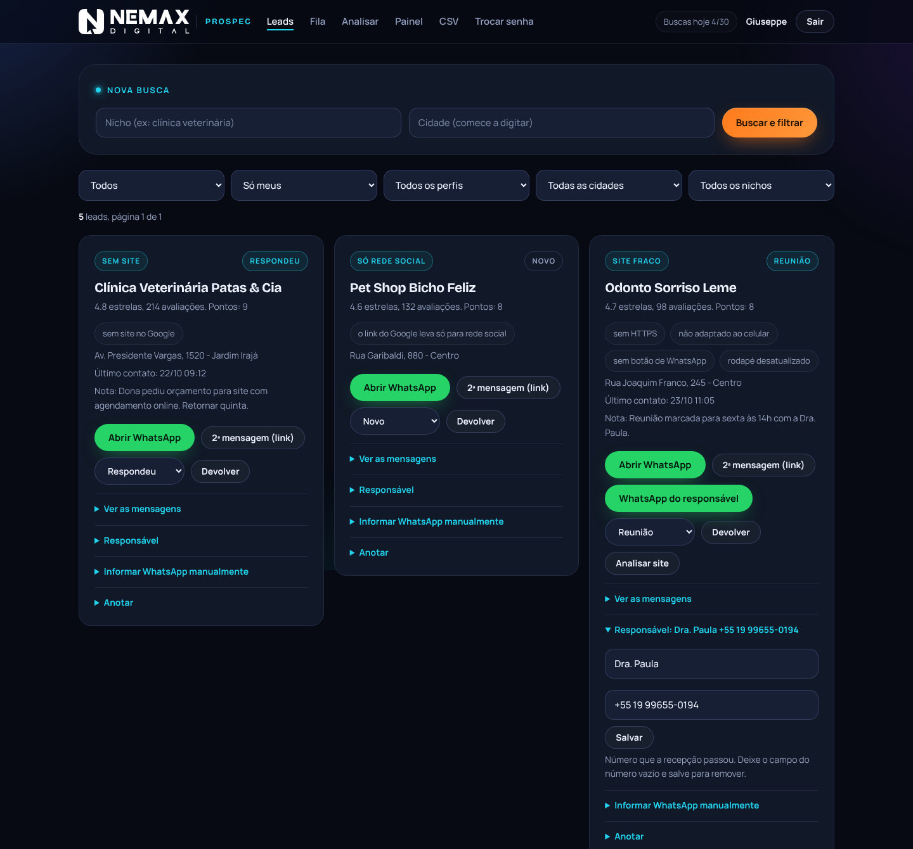
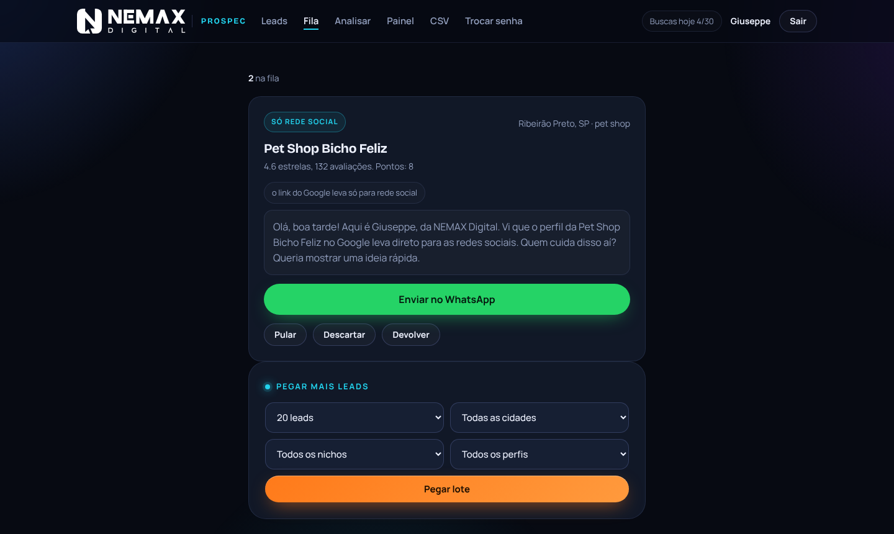
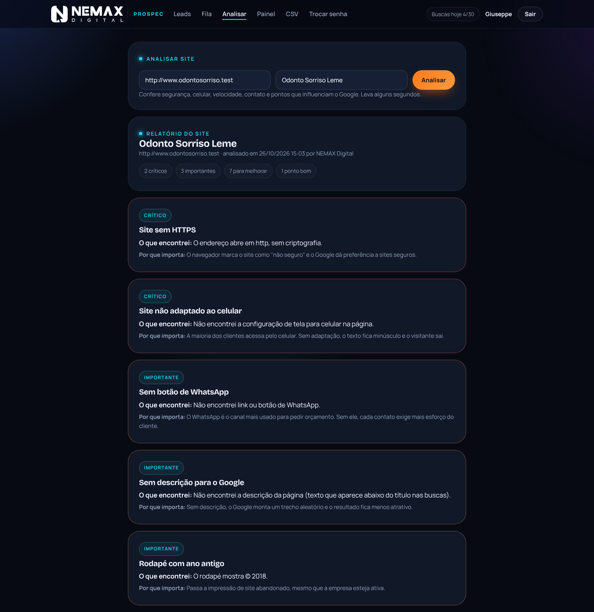
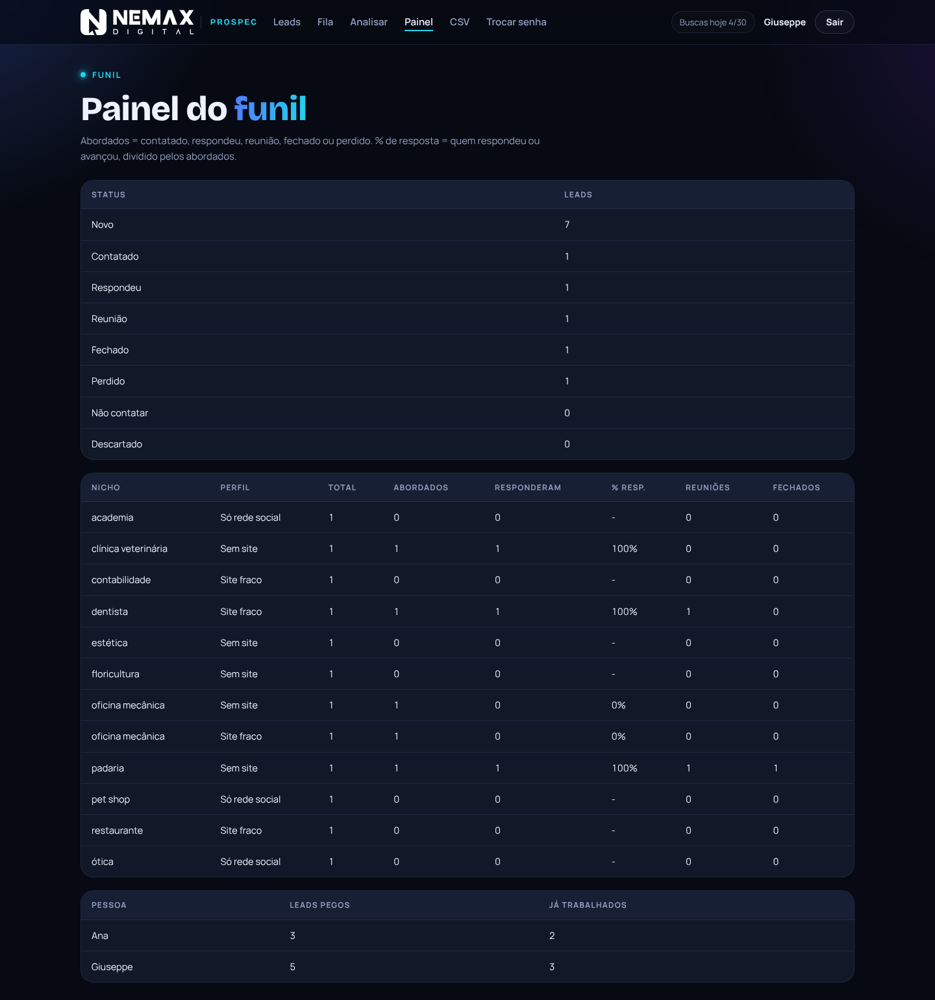
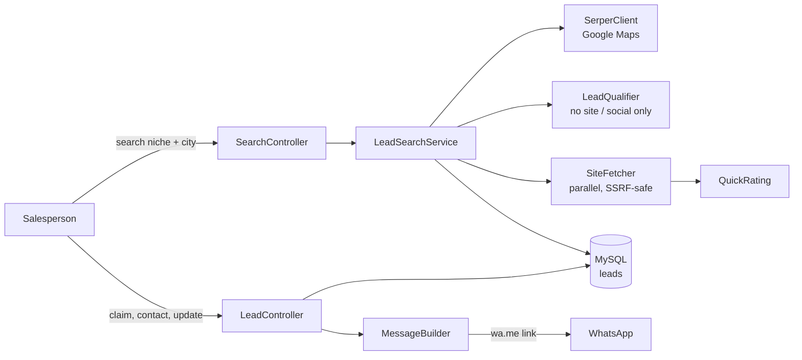

<div align="center">

# 🎯 Prospec

### Lead prospecting panel for a web design agency

[](https://github.com/itsnetomaset/prospec/actions/workflows/ci.yml)


</div>

---

## 🎯 The Problem

Selling websites to small local businesses starts with finding the right ones: companies that are active and well reviewed, but have no website, only a social media profile, or a site that is broken on mobile. Doing this by hand means searching Google Maps city by city, checking each site, keeping a spreadsheet and making sure two salespeople never contact the same business.

## ✅ The Solution

A team panel that turns a search like *"veterinary clinic in Ribeirão Preto"* into a scored, deduplicated lead list and a ready-to-send WhatsApp queue.

| Feature | Description |
|---|---|
| 🔎 **Search by niche and city** | Google Maps results via the Serper API, with autocomplete for all ~5,570 Brazilian municipalities (IBGE official list) |
| 🧮 **Automatic qualification** | Drops businesses with too few reviews and classifies the rest as *no website*, *social media only* or *weak website* |
| 🩺 **Website audit** | Checks a prospect's site for issues such as missing HTTPS or mobile viewport and turns each finding into a sales argument |
| 📊 **Lead funnel** | Status pipeline (new, contacted, replied, meeting, closed, lost) with a full action history per lead |
| 💬 **Outreach queue** | Personalized WhatsApp message per lead, opened with one click |
| 👥 **Multi-user** | Each lead has a single owner (atomic claim), with a daily search quota per user to control API cost |
| 📈 **Dashboard** | Reply and meeting rates by niche and lead profile; CSV export for admins |

> **Note:** the interface and the outreach messages are in Portuguese, as the tool prospects Brazilian businesses. Code, comments and documentation are in English. Database table and column names were kept in Portuguese for compatibility with the production database.

## 📸 Screenshots

> All businesses, phone numbers and websites below are fictional demo data.

**Lead list:** each card shows why the business is a prospect, its score, the last contact and note, and the WhatsApp actions.

<p align="center"></p>

**Outreach queue:** one lead at a time with the message ready. Opening WhatsApp marks the lead as contacted and loads the next one.

<p align="center">
  
  
</p>

**Website audit:** findings ranked by severity, each with what was found and why it matters to the owner, plus a ready-to-send summary.

<p align="center"></p>

**Funnel dashboard:** leads by status, reply rate by niche and profile, and workload per salesperson.

<p align="center"></p>

## 🏗️ Architecture

Plain PHP with no framework, organized in layers. Every dependency is passed through constructors, so each part can be tested in isolation.

```
public/          web root: front controller and static assets (the only public folder)
src/
  App.php        wiring and routing
  Controller/    one class per screen; translate HTTP into service calls
  Auth/          login, password change, brute-force throttle
  Lead/          Lead entity, filters, repositories, activity log
  Search/        Serper client, qualification rules, search orchestration, daily quota
  Site/          SSRF-safe parallel fetcher, quick rating, full website audit
  Outreach/      Brazilian phone normalization and WhatsApp message builder
  Geo/           IBGE municipality autocomplete
  Http/ View/    request, session, response and plain PHP templates
views/           templates (every value escaped with e())
database/        MySQL schema
tests/           PHPUnit unit and integration tests
```



**Design decisions**

- **External services behind interfaces.** `SearchProvider` and `SiteChecker` let the search pipeline run in tests with fakes, without network or API credits.
- **Atomic lead claim.** `UPDATE ... WHERE dono IS NULL` guarantees two salespeople never get the same business, without locks.
- **Single-use search token.** A double click or page refresh never spends a second paid search.
- **Reconnect after slow work.** Shared hosting MySQL drops idle connections while websites are checked, so the service reopens the connection before saving.
- **Runs without Composer.** A small PSR-4 fallback autoloader keeps the app deployable on shared hosting by plain upload; Composer is only needed for development.

## 🔒 Security

- Passwords stored as bcrypt hashes, with a forced password change on first login
- CSRF token on every form; strict Content Security Policy with no inline scripts or styles
- Login throttling by IP and by username; constant-cost check for unknown users
- SSRF protection when fetching prospect websites: only http/https on standard ports, only public IPv4, DNS answer pinned to the connection, redirects re-validated hop by hop, response size capped
- Prepared statements for every query; CSV export protected against spreadsheet formula injection
- Only `public/` is exposed by the web server; configuration and code live outside the web root

## 🧪 Tests

```bash
composer install
composer test   # PHPUnit: unit + integration suites
composer lint   # php -l on every file
```

- **Unit tests** cover the business rules: phone normalization, message copy, qualification and scoring, website rating and audit findings, SSRF guard, filters and CSV escaping.
- **Integration tests** run on a temporary SQLite database: repositories, authentication and throttling, the full search pipeline with fake providers, and end-to-end requests through the front controller (routing, CSRF, permissions, templates).
- **GitHub Actions** runs lint and tests on PHP 8.1, 8.2 and 8.3 for every push and pull request.

The refactoring from the original single-file version was checked against it with a characterization run: the same 55 scripted requests (login, searches against a mock Serper API, lead actions, queue, audits, dashboard, CSV) produced identical pages and identical database state in both versions.

## 🚀 Setup

1. Upload the project and point the domain's document root to `public/`. If the host does not allow that, upload everything to the web root: the root `.htaccess` routes requests to `public/` and blocks the rest.
2. Create a MySQL database and import `database/schema.sql`.
3. Copy `config.example.php` to `config.php` and fill in the database credentials, the Serper API key and the users.
4. Generate each user's initial password hash:
   ```bash
   php -r "echo password_hash('INITIAL_PASSWORD', PASSWORD_DEFAULT), PHP_EOL;"
   ```
5. Open the site and log in. The system asks for a new password on first access.

Requirements: PHP 8.1+ with `curl`, `mbstring` and `pdo_mysql`.

## 💡 What I Learned

The hard part was not the search but the team workflow: two people must never message the same business, quotas must hold under concurrent requests, and a slow website check must not break the database connection on shared hosting. Each of those became a small, explicit design decision instead of an assumption.

The tool started as a single 845-line file that worked well in production. Refactoring it into layers taught me to pin the current behavior first (a scripted run compared screen by screen) and only then move code, so the structure could change while the product did not.

---

<div align="center">

Built by [Giuseppe Maset Neto](https://www.linkedin.com/in/giuseppemasetneto) for [NEMAX Digital](https://nemaxdigital.com.br)

</div>
